:::: {.eb-home-hero .column-page}

::: {}
[Epidemiologist and data analyst · British Columbia]{.eyebrow}

# Emma Branch. [Epidemiology, maps, and fish.]{.accent}

::: {.lede}
I turn messy health and environmental data into analysis, maps, and stories people actually read. Twelve portfolio projects so far, from REDCap pipelines to whale sightings.
:::

[See the projects](#projects){.btn .btn-accent} [About me](#about-me){.btn .btn-ghost} [GitHub](https://github.com/emmabranch){.btn .btn-ghost}
:::

```{=html}
<div class="eb-flash-stack" role="region" aria-label="Flash sheets: each tattoo links to a project">
  <div class="eb-flash eb-page is-top" style="background:#00B386;--next:#FF6FB0">
    <p class="eb-flash-title">Flash sheet no. 1</p>
    <p class="eb-flip-row">
      <button type="button" class="eb-flip" data-dir="-1" aria-label="Previous flash sheet">‹</button>
      <button type="button" class="eb-flip eb-pause" aria-label="Pause flicking through the flash sheets"><svg class="i-pause" viewBox="0 0 12 12" aria-hidden="true"><rect x="2" y="1.5" width="3" height="9"/><rect x="7" y="1.5" width="3" height="9"/></svg><svg class="i-play" viewBox="0 0 12 12" aria-hidden="true"><path d="M3 1.5 L10.5 6 L3 10.5 Z"/></svg></button>
      <button type="button" class="eb-flip" data-dir="1" aria-label="Next flash sheet">›</button>
      <span class="eb-sheet-name">Source</span>
    </p>
    <div class="eb-flash-grid">
      <a class="eb-tile" href="https://emmabranch.github.io/ontario-claims-caribou/" aria-label="Fell: mining claims and caribou in Ontario"><span class="eb-tlabel"><span class="m">Fell</span><span class="p">Caribou</span></span></a>
      <a class="eb-tile" href="https://emmabranch.github.io/bc-wildfire-bigquery/" aria-label="Sparkle: BC wildfire history in BigQuery"><span class="eb-tlabel"><span class="m">Sparkle</span><span class="p">Wildfire</span></span></a>
      <a class="eb-tile" href="https://emmabranch.github.io/vch-climate-equity-profile/" aria-label="Thistle: climate resilience and equity in VCH communities"><span class="eb-tlabel"><span class="m">Thistle</span><span class="p">Equity</span></span></a>
      <span class="eb-tile eb-tile-empty" aria-hidden="true"><span class="eb-tlabel">Fell</span></span>
      <span class="eb-tile eb-tile-empty" aria-hidden="true"><span class="eb-tlabel">Fell</span></span>
      <span class="eb-tile eb-tile-empty" aria-hidden="true"><span class="eb-tlabel">Fell</span></span>
    </div>
    <p class="eb-flash-note">Tap a tattoo to open the project.</p>
    <button type="button" class="eb-curl" data-dir="1" aria-label="Turn to the next flash sheet"></button>
  </div>
  <div class="eb-flash eb-page" style="background:#FF6FB0;--next:#FF5A36" inert>
    <p class="eb-flash-title">Flash sheet no. 2</p>
    <p class="eb-flip-row">
      <button type="button" class="eb-flip" data-dir="-1" aria-label="Previous flash sheet">‹</button>
      <button type="button" class="eb-flip eb-pause" aria-label="Pause flicking through the flash sheets"><svg class="i-pause" viewBox="0 0 12 12" aria-hidden="true"><rect x="2" y="1.5" width="3" height="9"/><rect x="7" y="1.5" width="3" height="9"/></svg><svg class="i-play" viewBox="0 0 12 12" aria-hidden="true"><path d="M3 1.5 L10.5 6 L3 10.5 Z"/></svg></button>
      <button type="button" class="eb-flip" data-dir="1" aria-label="Next flash sheet">›</button>
      <span class="eb-sheet-name">People</span>
    </p>
    <div class="eb-flash-grid">
      <a class="eb-tile" href="https://emmabranch.github.io/redcap-starter-kit/" aria-label="Bumblebee: REDCap starter kit">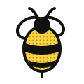<span class="eb-tlabel"><span class="m">Bumblebee</span><span class="p">REDCap</span></span></a>
      <a class="eb-tile" href="https://emmabranch.github.io/bc-housing-indicators/" aria-label="House: BC municipal housing indicators"><span class="eb-tlabel"><span class="m">House</span><span class="p">Housing</span></span></a>
      <a class="eb-tile" href="https://emmabranch.github.io/vch-climate-equity-profile/" aria-label="Thistle: climate resilience and equity in VCH communities"><span class="eb-tlabel"><span class="m">Thistle</span><span class="p">Equity</span></span></a>
      <span class="eb-tile eb-tile-empty" aria-hidden="true"><span class="eb-tlabel">Fell</span></span>
      <span class="eb-tile eb-tile-empty" aria-hidden="true"><span class="eb-tlabel">Fell</span></span>
      <span class="eb-tile eb-tile-empty" aria-hidden="true"><span class="eb-tlabel">Fell</span></span>
    </div>
    <p class="eb-flash-note">Tap a tattoo to open the project.</p>
    <button type="button" class="eb-curl" data-dir="1" aria-label="Turn to the next flash sheet"></button>
  </div>
  <div class="eb-flash eb-page" style="background:#FF5A36;--next:#B9A4FF" inert>
    <p class="eb-flash-title">Flash sheet no. 3</p>
    <p class="eb-flip-row">
      <button type="button" class="eb-flip" data-dir="-1" aria-label="Previous flash sheet">‹</button>
      <button type="button" class="eb-flip eb-pause" aria-label="Pause flicking through the flash sheets"><svg class="i-pause" viewBox="0 0 12 12" aria-hidden="true"><rect x="2" y="1.5" width="3" height="9"/><rect x="7" y="1.5" width="3" height="9"/></svg><svg class="i-play" viewBox="0 0 12 12" aria-hidden="true"><path d="M3 1.5 L10.5 6 L3 10.5 Z"/></svg></button>
      <button type="button" class="eb-flip" data-dir="1" aria-label="Next flash sheet">›</button>
      <span class="eb-sheet-name">Roads</span>
    </p>
    <div class="eb-flash-grid">
      <a class="eb-tile" href="https://emmabranch.github.io/bike-recall-surveillance/" aria-label="Coral: bike recall surveillance"><span class="eb-tlabel"><span class="m">Coral</span><span class="p">Recalls</span></span></a>
      <a class="eb-tile" href="https://emmabranch.github.io/gravel-geometry/" aria-label="Wave: gravel bike geometry explorer"><span class="eb-tlabel"><span class="m">Wave</span><span class="p">Gravel</span></span></a>
      <span class="eb-tile eb-tile-empty" aria-hidden="true"><span class="eb-tlabel">Fell</span></span>
      <span class="eb-tile eb-tile-empty" aria-hidden="true"><span class="eb-tlabel">Fell</span></span>
      <span class="eb-tile eb-tile-empty" aria-hidden="true"><span class="eb-tlabel">Fell</span></span>
      <span class="eb-tile eb-tile-empty" aria-hidden="true"><span class="eb-tlabel">Fell</span></span>
    </div>
    <p class="eb-flash-note">Tap a tattoo to open the project.</p>
    <button type="button" class="eb-curl" data-dir="1" aria-label="Turn to the next flash sheet"></button>
  </div>
  <div class="eb-flash eb-page" style="background:#B9A4FF;--next:#2340FF" inert>
    <p class="eb-flash-title">Flash sheet no. 4</p>
    <p class="eb-flip-row">
      <button type="button" class="eb-flip" data-dir="-1" aria-label="Previous flash sheet">‹</button>
      <button type="button" class="eb-flip eb-pause" aria-label="Pause flicking through the flash sheets"><svg class="i-pause" viewBox="0 0 12 12" aria-hidden="true"><rect x="2" y="1.5" width="3" height="9"/><rect x="7" y="1.5" width="3" height="9"/></svg><svg class="i-play" viewBox="0 0 12 12" aria-hidden="true"><path d="M3 1.5 L10.5 6 L3 10.5 Z"/></svg></button>
      <button type="button" class="eb-flip" data-dir="1" aria-label="Next flash sheet">›</button>
      <span class="eb-sheet-name">River</span>
    </p>
    <div class="eb-flash-grid">
      <a class="eb-tile" href="https://emmabranch.shinyapps.io/bc-salmon-explorer/" aria-label="Salmon: BC Salmon Explorer">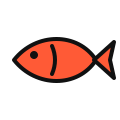<span class="eb-tlabel"><span class="m">Salmon</span><span class="p">Salmon</span></span></a>
      <a class="eb-tile" href="https://emmabranch.github.io/bc-lightstation-qc/" aria-label="Lighthouse: BC lightstation sea temperatures and the marine heatwave"><span class="eb-tlabel"><span class="m">Lighthouse</span><span class="p">Heatwave</span></span></a>
      <span class="eb-tile eb-tile-empty" aria-hidden="true"><span class="eb-tlabel">Fell</span></span>
      <span class="eb-tile eb-tile-empty" aria-hidden="true"><span class="eb-tlabel">Fell</span></span>
      <span class="eb-tile eb-tile-empty" aria-hidden="true"><span class="eb-tlabel">Fell</span></span>
      <span class="eb-tile eb-tile-empty" aria-hidden="true"><span class="eb-tlabel">Fell</span></span>
    </div>
    <p class="eb-flash-note">Tap a tattoo to open the project.</p>
    <button type="button" class="eb-curl" data-dir="1" aria-label="Turn to the next flash sheet"></button>
  </div>
  <div class="eb-flash eb-page eb-page-dark" style="background:#2340FF;--next:#00B386" inert>
    <p class="eb-flash-title">Flash sheet no. 5</p>
    <p class="eb-flip-row">
      <button type="button" class="eb-flip" data-dir="-1" aria-label="Previous flash sheet">‹</button>
      <button type="button" class="eb-flip eb-pause" aria-label="Pause flicking through the flash sheets"><svg class="i-pause" viewBox="0 0 12 12" aria-hidden="true"><rect x="2" y="1.5" width="3" height="9"/><rect x="7" y="1.5" width="3" height="9"/></svg><svg class="i-play" viewBox="0 0 12 12" aria-hidden="true"><path d="M3 1.5 L10.5 6 L3 10.5 Z"/></svg></button>
      <button type="button" class="eb-flip" data-dir="1" aria-label="Next flash sheet">›</button>
      <span class="eb-sheet-name">Sea</span>
    </p>
    <div class="eb-flash-grid">
      <a class="eb-tile" href="https://emmabranch.github.io/salish-sea-whales/" aria-label="Seal: whales of the Salish Sea">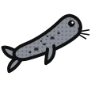<span class="eb-tlabel"><span class="m">Seal</span><span class="p">Whales</span></span></a>
      <a class="eb-tile" href="https://emmabranch.github.io/bc-fish-stock-status/" aria-label="Jellyfish: BC fish stock status">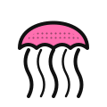<span class="eb-tlabel"><span class="m">Jellyfish</span><span class="p">Fisheries</span></span></a>
      <a class="eb-tile" href="https://emmabranch.github.io/scotland-seas-indicators/" aria-label="Puffin: State of Scotland's Seas"><span class="eb-tlabel"><span class="m">Puffin</span><span class="p">Scotland</span></span></a>
      <a class="eb-tile" href="https://emmabranch.github.io/bc-lightstation-qc/" aria-label="Lighthouse: BC lightstation sea temperatures and the marine heatwave"><span class="eb-tlabel"><span class="m">Lighthouse</span><span class="p">Heatwave</span></span></a>
      <span class="eb-tile eb-tile-empty" aria-hidden="true"><span class="eb-tlabel">Fell</span></span>
      <span class="eb-tile eb-tile-empty" aria-hidden="true"><span class="eb-tlabel">Fell</span></span>
    </div>
    <p class="eb-flash-note">Tap a tattoo to open the project.</p>
    <button type="button" class="eb-curl" data-dir="1" aria-label="Turn to the next flash sheet"></button>
  </div>
</div>
<script>
(() => {
  const stack = document.querySelector('.eb-flash-stack');
  if (!stack) return;
  const pages = [...stack.querySelectorAll('.eb-page')];
  const still = window.matchMedia('(prefers-reduced-motion: reduce)').matches;
  const EVERY = 6000;
  let i = 0, paused = still, hover = false, timer = null;
  const go = dir => {
    i = (i + dir + pages.length) % pages.length;
    pages.forEach((p, j) => { p.classList.toggle('is-top', j === i); p.inert = j !== i; });
  };
  const restart = () => { clearInterval(timer); if (!paused) timer = setInterval(() => { if (!hover) go(1); }, EVERY); };
  const showPaused = () => stack.querySelectorAll('.eb-pause').forEach(b => {
    b.classList.toggle('is-paused', paused);
    b.setAttribute('aria-label', paused ? 'Start flicking through the flash sheets' : 'Pause flicking through the flash sheets');
  });
  stack.querySelectorAll('[data-dir]').forEach(b => b.addEventListener('click', () => { go(Number(b.dataset.dir)); restart(); }));
  stack.querySelectorAll('.eb-pause').forEach(b => b.addEventListener('click', () => { paused = !paused; showPaused(); restart(); }));
  stack.addEventListener('mouseenter', () => { hover = true; });
  stack.addEventListener('mouseleave', () => { hover = false; });
  stack.addEventListener('focusin', () => { hover = true; });
  stack.addEventListener('focusout', () => { hover = false; });
  showPaused(); restart();
})();
</script>
```

::::

## Projects {#projects .column-page}

```{=html}
<div class="eb-proj-grid column-page">
  <article class="eb-proj">
    <a href="https://emmabranch.github.io/salish-sea-whales/" class="eb-proj-img">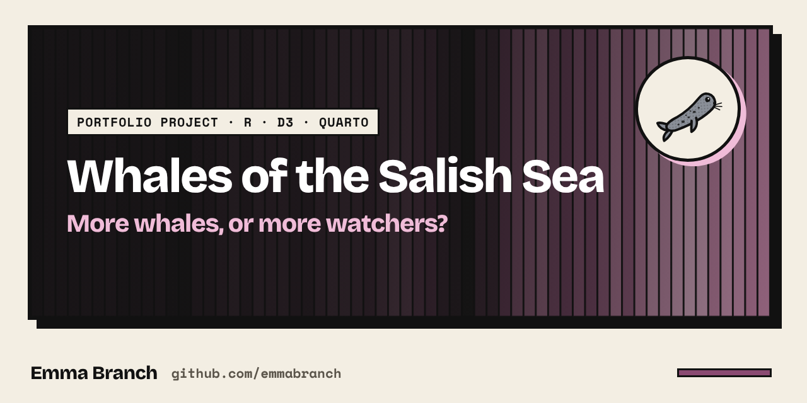</a>
    <div class="eb-proj-body">
      <h3><a href="https://emmabranch.github.io/salish-sea-whales/">Whales of the Salish Sea</a></h3>
      <p>More whales, or more watchers? An interactive story about 13,000 whale sightings.</p>
      <p class="eb-proj-tools">R · D3 · Quarto closeread</p>
      <p class="eb-proj-links"><a href="https://emmabranch.github.io/salish-sea-whales/">Live site</a> <a href="https://github.com/emmabranch/salish-sea-whales">Code</a></p>
    </div>
  </article>
  <article class="eb-proj">
    <a href="https://emmabranch.github.io/redcap-starter-kit/" class="eb-proj-img">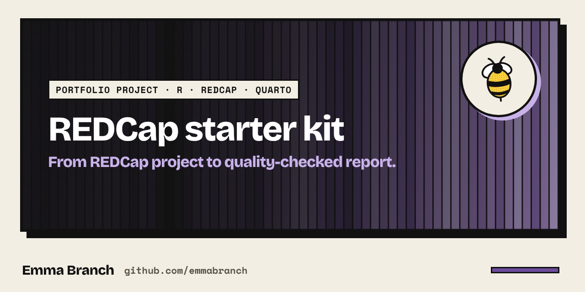</a>
    <div class="eb-proj-body">
      <h3><a href="https://emmabranch.github.io/redcap-starter-kit/">REDCap starter kit</a></h3>
      <p>From REDCap project to quality-checked report, with dictionary-driven cleaning and six data quality checks.</p>
      <p class="eb-proj-tools">R · REDCap · Quarto</p>
      <p class="eb-proj-links"><a href="https://emmabranch.github.io/redcap-starter-kit/">Live site</a> <a href="https://github.com/emmabranch/redcap-starter-kit">Code</a></p>
    </div>
  </article>
  <article class="eb-proj">
    <a href="https://emmabranch.github.io/bc-housing-indicators/" class="eb-proj-img">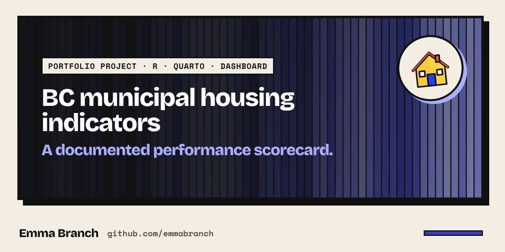</a>
    <div class="eb-proj-body">
      <h3><a href="https://emmabranch.github.io/bc-housing-indicators/">BC municipal housing indicators</a></h3>
      <p>A documented red, amber, and green scorecard for the 40 municipalities with housing targets.</p>
      <p class="eb-proj-tools">R · Quarto dashboard</p>
      <p class="eb-proj-links"><a href="https://emmabranch.github.io/bc-housing-indicators/">Live site</a> <a href="https://github.com/emmabranch/bc-housing-indicators">Code</a></p>
    </div>
  </article>
  <article class="eb-proj">
    <a href="https://emmabranch.github.io/bc-fish-stock-status/" class="eb-proj-img">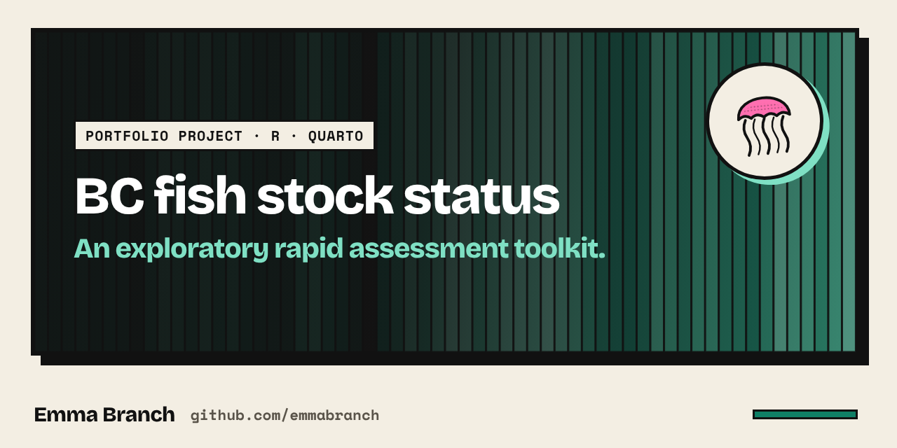</a>
    <div class="eb-proj-body">
      <h3><a href="https://emmabranch.github.io/bc-fish-stock-status/">BC fish stock status</a></h3>
      <p>An exploratory rapid assessment toolkit for ten BC fish and shellfish stocks.</p>
      <p class="eb-proj-tools">R · Quarto · closeread</p>
      <p class="eb-proj-links"><a href="https://emmabranch.github.io/bc-fish-stock-status/">Live site</a> <a href="https://github.com/emmabranch/bc-fish-stock-status">Code</a></p>
    </div>
  </article>
  <article class="eb-proj">
    <a href="https://emmabranch.github.io/bc-lightstation-qc/" class="eb-proj-img">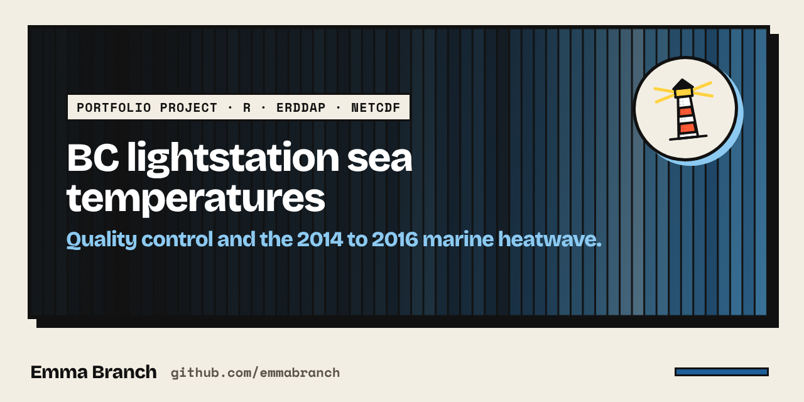</a>
    <div class="eb-proj-body">
      <h3><a href="https://emmabranch.github.io/bc-lightstation-qc/">BC lightstation sea temperatures</a></h3>
      <p>QARTOD quality control for about 140,000 daily ocean temperatures, published with a DOI.</p>
      <p class="eb-proj-tools">R · ERDDAP · NetCDF</p>
      <p class="eb-proj-links"><a href="https://emmabranch.github.io/bc-lightstation-qc/">Live site</a> <a href="https://github.com/emmabranch/bc-lightstation-qc">Code</a></p>
    </div>
  </article>
  <article class="eb-proj">
    <a href="https://emmabranch.github.io/bc-wildfire-bigquery/" class="eb-proj-img">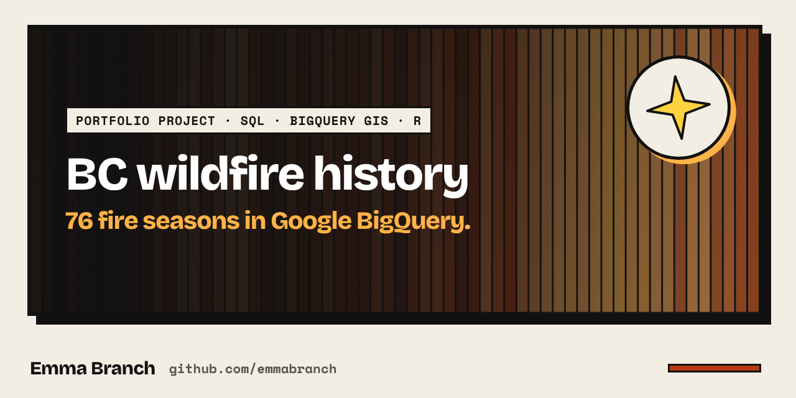</a>
    <div class="eb-proj-body">
      <h3><a href="https://emmabranch.github.io/bc-wildfire-bigquery/">BC wildfire history in BigQuery</a></h3>
      <p>76 fire seasons analysed with SQL and BigQuery GIS: not more fires, but far more area burned.</p>
      <p class="eb-proj-tools">SQL · BigQuery GIS · R</p>
      <p class="eb-proj-links"><a href="https://emmabranch.github.io/bc-wildfire-bigquery/">Live site</a> <a href="https://github.com/emmabranch/bc-wildfire-bigquery">Code</a></p>
    </div>
  </article>
  <article class="eb-proj">
    <a href="https://emmabranch.github.io/vch-climate-equity-profile/" class="eb-proj-img">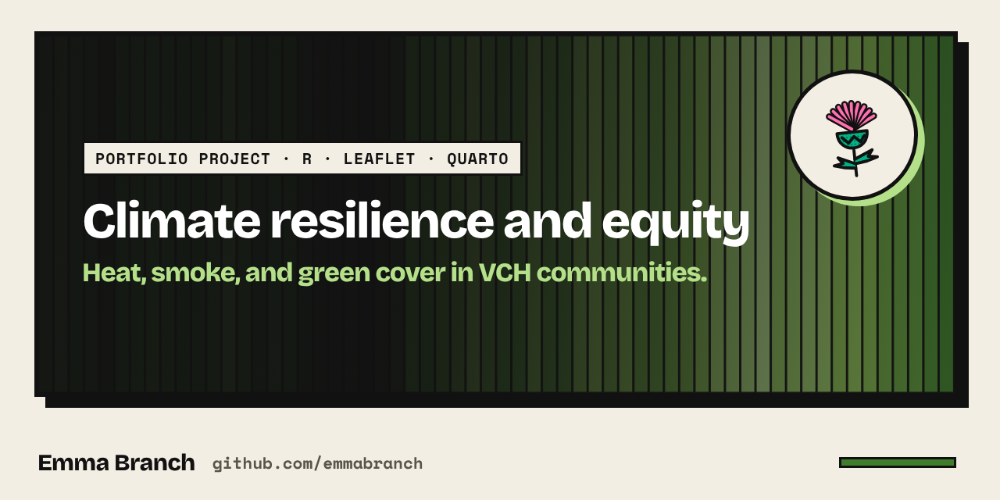</a>
    <div class="eb-proj-body">
      <h3><a href="https://emmabranch.github.io/vch-climate-equity-profile/">Climate resilience and equity profile of VCH communities</a></h3>
      <p>Social vulnerability to heat and smoke, alongside green cover, with a briefing note.</p>
      <p class="eb-proj-tools">R · leaflet · Quarto</p>
      <p class="eb-proj-links"><a href="https://emmabranch.github.io/vch-climate-equity-profile/">Live site</a> <a href="https://github.com/emmabranch/vch-climate-equity-profile">Code</a></p>
    </div>
  </article>
  <article class="eb-proj">
    <a href="https://emmabranch.shinyapps.io/bc-salmon-explorer/" class="eb-proj-img">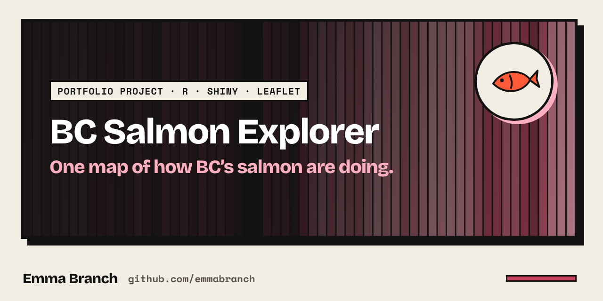</a>
    <div class="eb-proj-body">
      <h3><a href="https://emmabranch.shinyapps.io/bc-salmon-explorer/">BC Salmon Explorer</a></h3>
      <p>A Shiny app mapping 6,988 spawning streams, with Conservation Unit trends from mixed models.</p>
      <p class="eb-proj-tools">R · Shiny · leaflet</p>
      <p class="eb-proj-links"><a href="https://emmabranch.shinyapps.io/bc-salmon-explorer/">Live site</a> <a href="https://github.com/emmabranch/bc-salmon-explorer">Code</a></p>
    </div>
  </article>
  <article class="eb-proj">
    <a href="https://emmabranch.github.io/bike-recall-surveillance/" class="eb-proj-img">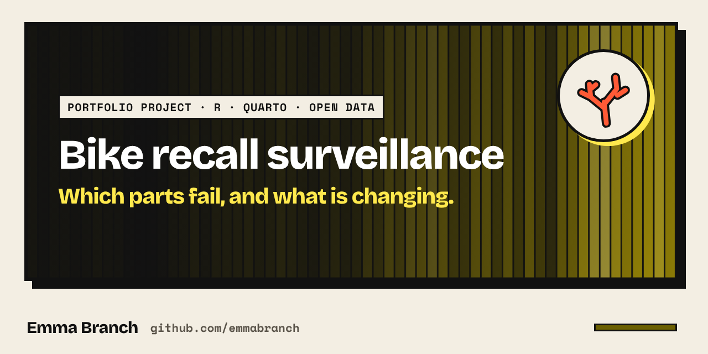</a>
    <div class="eb-proj-body">
      <h3><a href="https://emmabranch.github.io/bike-recall-surveillance/">Bike recall surveillance</a></h3>
      <p>508 bicycle, e-bike, and component recalls in the US and Canada, read like surveillance data.</p>
      <p class="eb-proj-tools">R · Quarto · Observable JS</p>
      <p class="eb-proj-links"><a href="https://emmabranch.github.io/bike-recall-surveillance/">Live site</a> <a href="https://github.com/emmabranch/bike-recall-surveillance">Code</a></p>
    </div>
  </article>
  <article class="eb-proj">
    <a href="https://emmabranch.github.io/gravel-geometry/" class="eb-proj-img">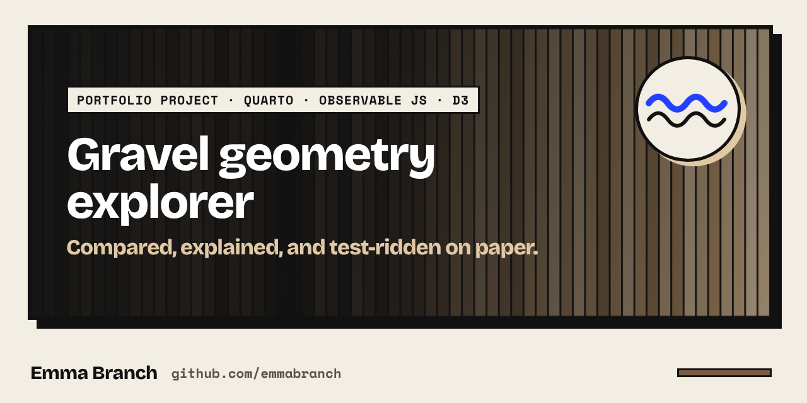</a>
    <div class="eb-proj-body">
      <h3><a href="https://emmabranch.github.io/gravel-geometry/">Gravel geometry explorer</a></h3>
      <p>24 gravel bikes compared and drawn to scale, with a rider overlay, a geometry builder, and five epi studies.</p>
      <p class="eb-proj-tools">R · Quarto · Observable JS</p>
      <p class="eb-proj-links"><a href="https://emmabranch.github.io/gravel-geometry/">Live site</a> <a href="https://github.com/emmabranch/gravel-geometry">Code</a></p>
    </div>
  </article>
  <article class="eb-proj">
    <a href="https://emmabranch.github.io/ontario-claims-caribou/" class="eb-proj-img">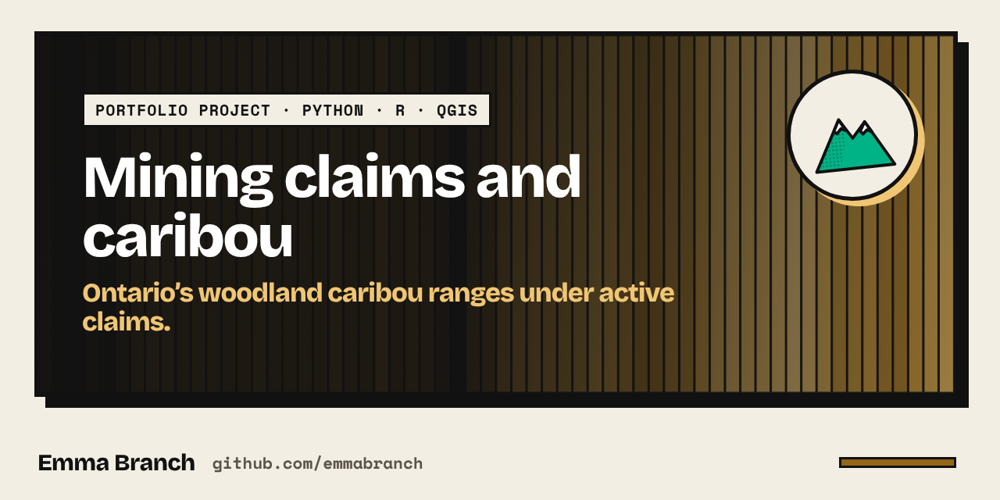</a>
    <div class="eb-proj-body">
      <h3><a href="https://emmabranch.github.io/ontario-claims-caribou/">Mining claims and caribou</a></h3>
      <p>Active mining claims cover about 50,900 km², or 10.6%, of Ontario's woodland caribou ranges.</p>
      <p class="eb-proj-tools">Python · R · QGIS</p>
      <p class="eb-proj-links"><a href="https://emmabranch.github.io/ontario-claims-caribou/">Live site</a> <a href="https://github.com/emmabranch/ontario-claims-caribou">Code</a></p>
    </div>
  </article>
  <article class="eb-proj">
    <a href="https://emmabranch.github.io/scotland-seas-indicators/" class="eb-proj-img">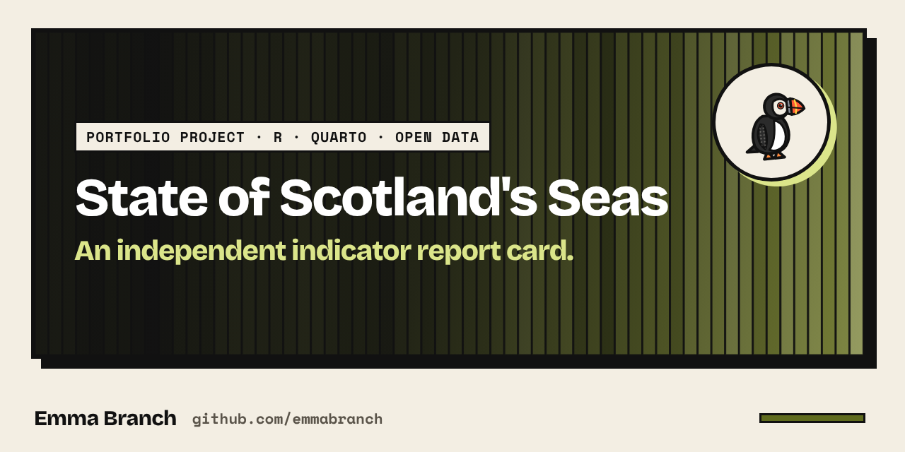</a>
    <div class="eb-proj-body">
      <h3><a href="https://emmabranch.github.io/scotland-seas-indicators/">State of Scotland's Seas</a></h3>
      <p>An independent indicator report card: seabirds after avian flu, seals, salmon, sea temperature, and protected areas.</p>
      <p class="eb-proj-tools">R · Quarto · leaflet · Observable JS</p>
      <p class="eb-proj-links"><a href="https://emmabranch.github.io/scotland-seas-indicators/">Live site</a> <a href="https://github.com/emmabranch/scotland-seas-indicators">Code</a></p>
    </div>
  </article>
</div>
```

## About me {#about-me}

I'm Emma Branch, an epidemiologist and data analyst in British Columbia, and a PhD candidate in Population and Public Health at the University of British Columbia. I've spent about 10 years working with health research data, including registry analytics, REDCap database design, data governance, and performance measurement. I mostly work in R, SAS, and SQL, and build reports and tools with Quarto, Shiny, leaflet, and Power BI. Lately I've been applying the same habits to environmental and ocean data, mostly because I like maps and fish.

[GitHub](https://github.com/emmabranch) · [LinkedIn](https://www.linkedin.com/in/embranch/) · [emma.branch@gmail.com](mailto:emma.branch@gmail.com)
